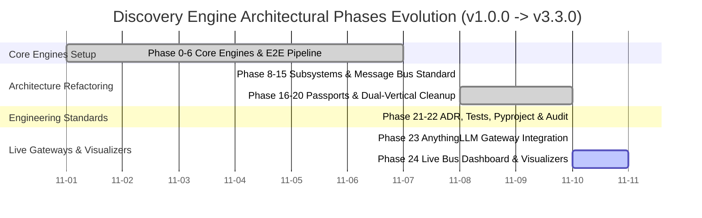
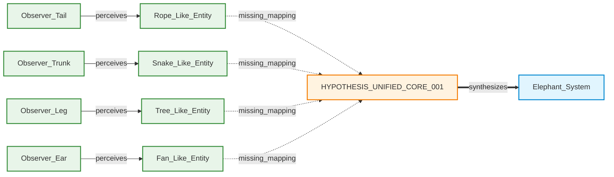
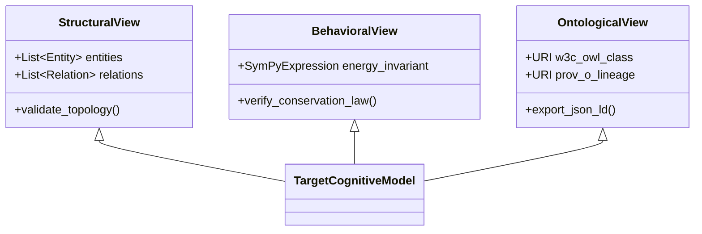

# Каталог шаблонів та класичних принципів візуалізації даних для Discovery Engine

Цей документ є фундаментальним довідником та каталогом паттернів інформаційного дизайну, створеним для підсистеми візуалізації проєкту **Discovery Engine** (v3.3.0) та її двосторонньої інтеграції з робочим простором **AnythingLLM** (`Discovery_Engine`).

---

## 1. Теоретичний фундамент інформаційного дизайну та семіології графіки

Створення функціональних візуальних інтерфейсів для складної нейро-символьної та топологічної системи спирається на класичні праці з теорії візуалізації даних, семіології та когнітивної психології сприйняття.

### 1.1. Едвард Тафті (Edward Tufte): Принцип мінімізації шуму та наочність причинності

Едвард Тафті у праці *«The Visual Display of Quantitative Information»* обґрунтував концепцію, згідно з якою графічна досконалість полягає у висвітленні складних ідей із найвищою чіткістю, ефективністю та лаконічністю.

* **Коефіцієнт «Дані-до-Чорнила» (Data-to-Ink Ratio)**:
  $$
  \text{Data-to-Ink Ratio} = \frac{\text{Графічне чорнило, використане для відображення даних}}{\text{Загальне чорнило, використане в діаграмі}}
  $$
  Основне правило Тафті вимагає максимізації цього коефіцієнта: кожна ризка, колір або піксель повинні нести корисну інформацію про дані.
* **Усунення графічного сміття (Chartjunk)**:
  Будь-які декоративні елементи (3D-об'єми, важкі фонові сітки, зайві рамки, візерунки) відволікають увагу та спотворюють сприйняття. Усі елементи інтерфейсу мають бути очищені від декоративного шуму.
* **Причинно-наслідкова наочність (Visual Explanations)**:
  Візуалізація складного процесу повинна показувати рух, причини та наслідки через чіткий розподіл у просторі та часі слів, чисел та графічних образів.

### 1.2. Стівен Ф'ю (Stephen Few): Моніторинг за 5 секунд та архітектура дашбордів

Стівен Ф'ю у працях *«Information Dashboard Design»* та *«Show Me the Numbers»* сформулював концепцію дашборда як єдиного екранного простору, розробленого для миттєвого огляду:

* **Правило 5 секунд (At-a-Glance Monitoring)**:
  Оператор повинен зчитувати поточний стан системи, ключові відхилення та аномалії протягом 5 секунд без додаткового прокручування або контекстного перемикання.
* **Типові помилки дизайну інформаційних панелей**:
  1. *Перевищення розмірів екрана* (необхідність скролінгу руйнує цілісність сприйняття).
  2. *Недостатній або відсутній контекст* (відображення сухих чисел без порогових значень чи трендів).
  3. *Надмірне візуальне розмаїття* (використання відмінних типів діаграм лише заради краси).
  4. *Погано спроектована візуальна ієрархія* (найважливіші метрики розміщуються не у первинній зоні фіксації погляду).

### 1.3. Жак Бертін (Jacques Bertin): Семіологія графіки та зорові змінні

Жак Бертін у класичній монографії *«Semiology of Graphics»* систематизував графічну комунікацію як мовну систему, ввівши поняття 8 основних зорових змінних:

1. **Розташування в просторі (Position)**: двовимірні координати $(X, Y)$ — найсильніша змінна для передачі зв'язку.
2. **Розмір (Size)**: передає кількісні співвідношення та ієрархічну значущість.
3. **Форма (Shape)**: кодує якісні відмінності та категоризацію сутностей.
4. **Тон / Значення (Value / Tone)**: градація від світлого до темного, кодує впорядковані або інтенсивніші значення.
5. **Колірний тон (Color Hue)**: ідентифікує класи та підсистеми (не повинен перевищувати 5–7 контрастних відтінків на одному екрані).
6. **Орієнтація (Orientation)**: кодує напрямки векторів або статус потоку.
7. **Текстура (Texture)**: кодує внутрішні властивості або стан агрегації.
8. **Тип геометричного знака**: точка, лінія або площа.

### 1.4. Альберто Каір (Alberto Cairo): Візуалізація як «Функціональне мистецтво»

Альберто Каір у книзі *«The Functional Art»* визначає інформаційну графіку як інструмент пізнання. Він розробив **Колесо візуалізації (Visualization Wheel)**, що описує баланс між протилежними вимірами дизайну:
* *Абстракція ↔ Фігуративність*
* *Спрощення ↔ Щільність інформації*
* *Линійність ↔ Багатовимірність*
* *Декоративність ↔ Функціональність*

Для наукових та інженерних систем Каір рекомендує зміщення в бік щільності, багатовимірності та високої функціональності.

### 1.5. Колін Вор (Colin Ware): Приатентивне сприйняття та когнітивна психологія

Колін Вор у працях *«Visual Thinking: for Design»* та *«Information Visualization: Perception for Design»* пояснює психофізіологію зору:

* **Приатентивне (доуважне) опрацювання**:
  Людський мозок виявляє певні візуальні властивості (яскравий червоний колір серед сірих елементів, зміщена лінія, великий розмір) за 200 мілісекунд, ще до підключення свідомого аналізу.
* **Зниження когнітивного навантаження**:
  Колірний контраст та просторове групування повинні спрямовувати увагу оператора безпосередньо на критичні аномалії (DLQ-черга, виявлені топологічні гапи $H_1$).

### 1.6. Вольфґанґ Айґнер та Даніель Розенберг: Візуалізація часових даних

Вольфґанґ Айґнер (*«Visualization of Time-Oriented Data»*) та Даніель Розенберг (*«Cartographies of Time»*) виділяють 3-факторний підхід до систем із часовим виміром:
1. **Предмет (Дані)**: події, фази, транзакційні повідомлення.
2. **Причина (Завдання)**: аналіз еволюції системи, пошук затримок чи збоїв у часі.
3. **Спосіб (Проектування)**: лінійні часові шкали, топологічні фазові діаграми.

---

## 2. Специфікація 6 системних візуалізаційних шаблонів Discovery Engine

Спираючись на сформований теоретичний фундамент, нижче наведено 6 конкретних шаблонів візуалізації, розроблених для генерації модулями Вузла 00 та відображення у робочому просторі AnythingLLM.

### 2.1. Шаблон 1: Executive At-a-Glance Bus Dashboard

* **Теоретична основа**: Стівен Ф'ю (Rule of 5 Seconds) + Едвард Тафті (Data-to-Ink Ratio).
* **Призначення**: Забезпечити миттєвий моніторинг стану транзакційної шини `Bridge/messages.jsonl` без візуального шуму.
* **Формат генерації**: Markdown із суворими таблицями та плашкою статусу.

#### Структура шаблону

```markdown
# ⚡ Live Message Bus Status — [TIMESTAMP]
**Header Status:** 🟢 SYSTEM ALL OK | ACTIVE PHASE: v3.3.0 | DLQ COUNT: 0

### Operational Metrics
| Metric | Value | Status | Threshold Standard |
| :--- | :---: | :---: | :--- |
| Pending Directives | **0** | 🟢 Nominal | <= 3 pending |
| Completed Tasks | **42** | 🟢 Nominal | Dynamic growth |
| Failed / DLQ Messages | **0** | 🟢 Nominal | Strict 0 |
| Circuit Breaker Hops | **1** | 🟢 Nominal | Max 3 hops |

### Vector Activity Distribution
- **vertical** `(system.master_architect ➔ cline.executor)`: 18 messages
- **interface_to_anythingllm** `(interface.operator ➔ aggregator.architect)`: 12 messages
- **diagonal** `(core.tda_engineer ➔ aggregator.osint_analyst)`: 12 messages
```

---

### 2.2. Шаблон 2: Time-Oriented Phase Topology & Milestone Timeline

* **Теоретична основа**: Вольфґанґ Айґнер (Часові дані) + Даніель Розенберг (Картографія часу).
* **Призначення**: Відображення еволюції архітектурних фаз проєкту (від Phase 0 до Phase 24+) та міграції системного маніфесту.
* **Формат генерації**: Mermaid Gantt / Timeline у Markdown.

#### Специфікація Mermaid



---

### 2.3. Шаблон 3: Semantic Knowledge Network & RDF Triples Graph

* **Теоретична основа**: Жак Бертін (Семіологія графіки) + Роберт Клантен (Data Flow).
* **Призначення**: Наочне кодування семантичних знань, нормалізованих Вузлом 05 (`Knowledge Aggregator`) та переданих у Вузол 01 (`Formal Core`).
* **Зорові змінні**:
  * *Форма вузла*: Квадрат (`core:Entity`), Овал (`Subject`/`Object`).
  * *Колір вузла*: Синій (`System Core`), Зелений (`Ingested Fact`), Помаранчевий (`Unverified Hypothesis`).
* **Формат генерації**: Mermaid Graph / Graphviz DOT.

#### Специфікація Mermaid



---

### 2.4. Шаблон 4: TDA Betti Gap & Invariant Visualizer

* **Теоретична основа**: Колін Вор (Приатентивне сприйняття) + Альберто Каір (Функціональне мистецтво).
* **Призначення**: Візуалізація результатів топологічного аналізу даних (Vietoris-Rips TDA), алгебраїчних інваріантів SymPy та ізольованих компонент зв'язаності.
* **Формат генерації**: Markdown з LaTeX-формулами та картками аномалій.

#### Структура шаблону

```markdown
# 📐 Topological Data Analysis (TDA) & Invariants Spec

### 1. Betti Numbers & Homological Topology
- **Zero-dimensional Homology ($H_0$)**: $b_0 = 5$ (Disconnected Connected Components)
- **One-dimensional Homology ($H_1$)**: $b_1 = 0$ (No Cycles Detected)

### 2. Symbolic CAS Invariant Grounding (SymPy)
$$
E_{\text{total}} - (E_{\text{tail}} + E_{\text{trunk}} + E_{\text{leg}} + E_{\text{ear}}) = 0
$$

### 3. Detected Topological Structural Gaps
> ⚠️ **GAP DETECTED**: `DISCONNECTED_COMPONENT` (Index 0..4)
> **Hypothesis**: Missing central unifying core mapping (`Universal_Elephant_Core`)
> **Action**: Signal Node 05 for target concept ingestion.
```

---

### 2.5. Шаблон 5: ISO/IEC/IEEE 42010 3-View Target Model

* **Теоретична основа**: Едвард Тафті (Visual Explanations) — багатовимірне розкриття причинно-наслідкових зв'язків.
* **Призначення**: Візуальне відображення математично заземленого цільового когнітивного об'єкта Вузла 06 (`Formalized Model`) у трьох стандартних проекціях.
* **Формат генерації**: 3-колонкова Markdown матриця та Mermaid клас-діаграма.

#### Специфікація Mermaid Class Diagram



---

### 2.6. Шаблон 6: Visual Architecture Decision Record & Interaction Matrix

* **Теоретична основа**: Девід Сіббет (*«Visual Meetings»*) — графічна фасилітація та мапування взаємодій.
* **Призначення**: Наочне відображення мапи ролей, векторів комунікації та журналу прийнятих архітектурних рішень (ADR 0001–0005).
* **Формат генерації**: Markdown підсумок та сувора матриця доступу.

#### Матриця векторів та рішень

```markdown
# 🏛️ Architectural Governance & ADR Matrix (v3.3.0)

### Registered Actor Roles & Allowed Vectors
| Role | Node | Allowed Outbound Vectors | Active Subscriptions |
| :--- | :---: | :--- | :--- |
| `system.master_architect` | Master | `vertical`, `broadcast` | Directives, Status Reports |
| `cline.executor` | Master | `vertical`, `system` | Execution Commands |
| `aggregator.architect` | Node 05 | `interface_to_anythingllm`, `aggregator` | Intake Schemas |
| `core.tda_engineer` | Node 01 | `diagonal`, `core` | Graph Triples |
| `model.builder` | Node 06 | `model`, `broadcast` | 3-View Models |
| `interface.operator` | Node 00 | `interface_to_anythingllm` | Operator Prompts |

### Architecture Decision Records (ADR Log)
- **ADR 0001**: Dual-Vertical Governance Standard (`PROJECT_STATE.md` + `PROJECT_CONTEXT.md`).
- **ADR 0002**: Project Trash Bin Policy (`Bridge/trash/`).
- **ADR 0003**: Single-Prompt Gateway Execution Protocol.
- **ADR 0004**: General File Audit & 2-File Node Envelope Standard.
- **ADR 0005**: Live Bus Dashboard & AnythingLLM Visualizer Integration.
```

---

## 3. Технічний регламент генерування та індексації у Вузлі 00 й AnythingLLM

Щоб згенеровані візуалізаційні шаблони ставали доступними для аналізу у робочому просторі **AnythingLLM**, встановлюється наступний автоматичний конвеєр.

```mermaid
flowchart LR
    A[Bridge/messages.jsonl] --> B[00_Project_Interface/src/bus_dashboard.py]
    B -->|Generate Markdown & Mermaid| C[00_Project_Interface/out/bus_dashboard.md]
    C --> D[00_Project_Interface/src/anythingllm_gateway.py --sync-dashboard]
    D -->|REST API /v1/workspace/update-embeddings| E[AnythingLLM Workspace: Discovery_Engine]
    E --> F[LanceDB Vector Store / RAG Context]
```



### 3.1. Алгоритм автоматичного зняття зрізів

1. **Тригер виконання**: При виконанні нової фази або зміні стану шини Клін запускає модуль генерації:
   ```bash
   python 00_Project_Interface/src/bus_dashboard.py --export-md
   ```
2. **Формування файлу**: Модуль створює підсумковий файл згідно з Шаблонами 1–6 і зберігає його за шляхом `00_Project_Interface/out/bus_dashboard.md`.
3. **Публікація у AnythingLLM**: Шлюз відправляє файл у локальний векторний простір AnythingLLM:
   ```bash
   python 00_Project_Interface/src/anythingllm_gateway.py --sync-dashboard --api-key AC2DW6K-E5T4QV7-PWHYFTG-E8KXP50 --workspace Discovery_Engine
   ```
4. **Індексація**: Векторний рушій **LanceDB** автоматично перераховує відбитки (embeddings), роблячи графічні мапи та матриці доступними для інтерактивних запитів користувача та мовних моделей `Qwen 2.5`, `Gemma 2` та `Llama 3.1`.

---
*Документ затверджено для застосування у Вузлі 00 (`00_Project_Interface`) та робочих просторах AnythingLLM (Фаза 24 v3.3.0).*
